# YogyataMitra (योग्यता मित्र)

> **Explainable, Deterministic, and Auditable GovTech Welfare Entitlement Platform**  
> *Master Architectural Specification and Product Source of Truth*

---

## Master Implementation Status & Claim Discipline

To ensure absolute fidelity between documentation and codebase reality, YogyataMitra enforces strict claim discipline across four distinct documentation tiers:

1. **CURRENT IMPLEMENTATION (IMPLEMENTED / VERIFIED)**: Code, database schemas, APIs, services, and tests that are physically present, active, and verified in `D:\YogyataMitra`.
2. **IN PROGRESS**: Features where foundational backend models or APIs exist, but frontend wiring, complete end-to-end integration, or two-way workflows are currently being assembled.
3. **PLANNED ARCHITECTURE (PLANNED / ROADMAP)**: Agreed future architectural specifications, data contracts, and target capabilities designed for upcoming development phases.
4. **DEMONSTRATION ASSUMPTIONS**: Operational parameters (e.g., target turnaround days, officer case capacities) utilized for simulation, testing, and academic evaluation.

> [!IMPORTANT]
> **Foundational Implementation vs. Full End-to-End Hardening**:  
> Where a core subsystem is active in the repository, the documentation explicitly distinguishes between:
> - **Foundation Implemented**: Core domain models, state machines, or service abstractions are operational in the codebase.
> - **Full Feature Planned / Hardening Planned**: End-to-end citizen-officer round-trip interfaces, dynamic form generation, or comprehensive bypass-hardening scheduled under specific roadmap phases.

### Implementation Status Matrix

| Subsystem / Capability | Architectural Role | Current Status | Verification Evidence / Reference |
|---|---|---|---|
| **Deterministic Evaluator** | Core Engine | **IMPLEMENTED / VERIFIED** | Pure AST execution, Strong Kleene 3-valued logic, zero heuristic branching (`backend/app/engine/evaluator/`) |
| **Bilingual Policy Explanations** | Core Engine | **IMPLEMENTED / VERIFIED** | English & Hindi 6-question breakdown (`backend/app/engine/explainability/`, `claimPresentation.ts`) |
| **Append-Only Audit Logging** | Core Engine | **IMPLEMENTED / VERIFIED** | `HumanReviewAuditEvent`, immutable trail, `/audit-history` public view and case history tab |
| **Active Policies & Canonical Versions** | Policy Layer | **IMPLEMENTED / VERIFIED (10/10 Schemes)** | All 10 schemes (14 canonical policy versions) with deterministic AST rulesets and verified SHA-256 hashes |
| **Ten Target Schemes Portfolio** | Policy Layer | **IMPLEMENTED / VERIFIED (10/10 Schemes)** | `PM_KISAN`, `SSY`, `PM_KMY`, `PMUY`, `PM_VISHWAKARMA`, `PMAY_G`, `PMAY_U_2_0`, `PM_SVANIDHI`, `PMMVY`, `IGNOAPS` (Phase H) |
| **Policy Test Suite** | Quality Assurance | **IMPLEMENTED / VERIFIED (40/40 Scenarios)** | Exactly 4 canonical scenarios per scheme × 10 schemes = 40 canonical policy scenarios verified (`tests/test_generic_policy_forms_phase_h.py`) |
| **Historical Version Preservation** | Data Integrity | **IMPLEMENTED / VERIFIED** | Journey immutably bound to historical `PolicyVersionId`; past decisions never mutate upon policy updates |
| **Official Document Provenance** | Provenance | **IMPLEMENTED / VERIFIED (Phase I)** | Statutory source registry, document versioning, separate AST & document SHA-256 integrity, rule-level clause locators, read-only transparency API, and audit trail (`tests/test_provenance_phase_i.py`) |
| **Policy Update Detection & Sandbox** | Back-Office | **FOUNDATION IMPLEMENTED** | Discovery service, candidate diffing, hash checks, triage UI in `/officer/policy-discovery`. Continuous monitoring planned in Phase J |
| **Mandatory Verification Evaluation Gate**| Entitlement Gate| **FOUNDATION IMPLEMENTED** | Foundational gate blocks unverified evidence; Phase F hardens and closes remaining bypass/integration paths |
| **Generic Policy Architecture** | Domain Layer | **IMPLEMENTED / VERIFIED (Phases G & H)** | Declarative version-bound policy form metadata, generic sections/fields, conditional applicability, cross-field rules, and dynamic form renderer (`/citizen/applications/new`) |
| **Itemized Evidence Verification** | Officer Portal | **IMPLEMENTED / VERIFIED** | Officer inspects evidence, records findings, and notes in `/officer/cases/[journeyId]` |
| **Officer Authentication** | Access Control | **IMPLEMENTED / VERIFIED** | `/officer/login`, JWT Bearer token authentication, pre-seeded officer profiles, role enforcement |
| **Departmental Verification Queue** | Officer Portal | **IMPLEMENTED / VERIFIED** | `/officer/queue`, aggregate metrics (`total`, `pending`, `in_review`, `escalated`, `completed`), status & scheme filtering. Manual/pool-based assignment currently |
| **Citizen Scheme Browsing** | Public Website | **IMPLEMENTED / VERIFIED** | Public landing `/`, scheme catalog `/schemes`, individual scheme view `/schemes/[schemeCode]`, version timeline |
| **Eligibility Journey Stepper** | Citizen Journey | **IMPLEMENTED / VERIFIED** | `/eligibility` step-by-step facts input, document upload, and deterministic evaluation execution |
| **Application Lifecycle & FSM** | Workflow Engine | **FOUNDATION IMPLEMENTED** | FSM/journey foundation implemented; complete end-to-end round-trip workflow remains in progress/planned |
| **Evidence Verification & Clarification Workflow** | Workflow Engine | **IMPLEMENTED / VERIFIED (Phase E FROZEN)** | Multi-round evidence verification findings, officer clarification requests, IDOR-protected citizen response, replacement evidence, derived readiness (`tests/test_evidence_clarification_phase_e.py`) |
| **Citizen Authentication & RBAC** | Access Control | **IMPLEMENTED / VERIFIED (Phase A FROZEN)** | `/citizen/login`, `/citizen/signup`, role-isolated JWT tokens, unified role selector (`tests/test_auth_phase_a.py`) |
| **Citizen Multi-Application Dashboard** | Citizen Portal | **IMPLEMENTED / VERIFIED (Phase B FROZEN)** | `/citizen/dashboard`, `/citizen/applications`, multi-scheme tracking, IDOR-protected (`tests/test_citizen_applications_phase_b.py`) |
| **Generic Application Creation & Submission** | Citizen Journey | **IMPLEMENTED / VERIFIED (Phase C FROZEN)** | `/citizen/applications/new`, draft lifecycle, requirement preflight, immutable submission (`tests/test_citizen_phase_c.py`) |
| **Backend Workload Balancer & Operational SLA** | Officer Portal | **IMPLEMENTED / VERIFIED (Phase D FROZEN)** | Least-loaded routing, capacity limits (15 cases), dynamic SLA computation (`NOT_DUE`, `DUE_SOON`, `OVERDUE`), auditable reassignment, role-enforced reassignment boundaries (`tests/test_officer_assignment_phase_d.py`) |
| **Deterministic Evaluation & Decision Engine** | Entitlement Engine | **IMPLEMENTED / VERIFIED (Phase F FROZEN)** | Pure AST evaluation against bound policy version, 4 statutory outcomes (`ELIGIBLE`, `INELIGIBLE`, `INSUFFICIENT_INFORMATION`, `VERIFICATION_REQUIRED`), server-side verified fact provenance gate, row-level concurrency lock, append-only `EvaluationTrace` with journey linkage, officer assignment auth, citizen decision IDOR (`tests/test_deterministic_evaluation_phase_f.py`) |
| **Production Hardening & E2E Verification** | Verification & Security | **IMPLEMENTED / AWAITING AUDIT (Phase J)** | End-to-end citizen & officer lifecycle, 10-scheme verification matrix, DB immutable trigger (`trg_provenance_audit_events_immutable`), provenance path sanitization, synthetic demo seed/reset script (`tests/test_phase_j_end_to_end.py`) |
| **Government Design System & Motion** | User Interface | **IMPLEMENTED / VERIFIED** | National Navy & Tiranga palette, Inter/Devanagari typography, high-contrast cards, restrained micro-interactions. Usability polish in Phase K |

---

## 1. Product Vision

**YogyataMitra** (योग्यता मित्र — *"Friend of Eligibility"*) is an explainable, deterministic GovTech welfare entitlement reasoning and verification platform. It bridges the structural divide between complex statutory policies enacted by the Government of India and the citizens seeking social security entitlements.

### The Core Entitlement Chain

Every entitlement determination in YogyataMitra follows an unbroken, auditable chain of statutory custody:


1. **Government Policy**: Legislative acts, Gazetted notifications, and official operational guidelines issued by Union and State ministries.
2. **Structured Rules**: Declarative, schema-agnostic Abstract Syntax Tree (AST) rules governed by Strong Kleene 3-valued logic (`TRUE`, `FALSE`, `UNKNOWN`).
3. **Citizen Facts**: Factual claims asserted by the applicant (e.g., cultivable land area, beneficiary age, household income bracket).
4. **Evidence**: Physical or digital documentation submitted by the citizen to corroborate claimed facts (e.g., Record of Rights, Aadhaar card, Birth Certificate, Bank Passbook).
5. **Officer Verification**: Human-in-the-loop review by authorized welfare officers verifying whether the submitted evidence is authentic, reliable, and sufficient.
6. **Deterministic Evaluation**: Pure, mathematical rule execution without heuristic approximations, LLM hallucinations, or arbitrary administrative discretion.
7. **Explanation**: Complete bilingual (English & Hindi) statutory explanations detailing which criteria passed, which exclusions triggered, and which facts remain unresolved.
8. **Audit**: Immutable, append-only chronological audit logging recording every transition, evaluation trace, officer verification findings, and policy version hash.

### Statutory Boundary & Scope Disclaimer

> [!IMPORTANT]
> **YogyataMitra is an eligibility reasoning and assistance platform. It does NOT replace:**
> - Government administrative authorities (Ministries, Directorates, Departments)
> - Authoritative government databases (UIDAI, PFMS, Land Records / Bhulekh, Income Tax Portal)
> - Disbursing financial institutions (Banks, Post Offices, Treasury)
> - Local statutory bodies (Gram Sabha, Urban Local Bodies / ULBs, Ward Committees)
> - Competent administrative or quasi-judicial decision-makers (District Level Committees, Tahsildars, Welfare Officers)
>
> YogyataMitra equips citizens with transparent eligibility insight and provides welfare administration with structured evidence dossiers and mathematical verification tools. Official sanction, approval, and monetary disbursement remain strictly within the statutory jurisdiction of the competent government authorities.

---

## 2. Product Roles — Exactly Two User-Facing Roles

YogyataMitra enforces an explicit two-role product model:

| Product Role | Entity / Persona | Purpose & Functional Boundary |
|---|---|---|
| **Citizen** (`CITIZEN`) | Applicant / Beneficiary | Browses public schemes, authenticates, manages profile, submits welfare applications, uploads documentary evidence, tracks application status, and responds to clarification requests. |
| **Officer** (`OFFICER`) | Welfare Verification Officer | Authenticates via secure administrative access, inspects assigned case dossiers, verifies submitted evidence, records verification findings, and initiates/records the platform's deterministic eligibility assessment. Statutory sanction/approval remains with the competent government authority. |

### Note on Supervisory Functions & Role Boundaries

- **No AUDITOR Product Role**: Auditability is a pervasive system capability and dedicated view within the platform, **not** a distinct citizen-facing or officer-facing product role.
- **Supervisor / Admin Are Internal Permissions**: Internal administrative functions (e.g., escalation handling, supervisory second-sign-off, policy draft approval) represent **internal permissions and privileged administrative functions** granted to designated officer profiles within the Officer-side administrative environment (e.g., `role: "SUPERVISOR"` or `role: "ADMIN"`). They do **not** constitute a third public-facing product persona.

---

## 3. Public Website

`[STATUS: IMPLEMENTED / VERIFIED]`

The unauthenticated public website serves as the national information portal for statutory welfare transparency:

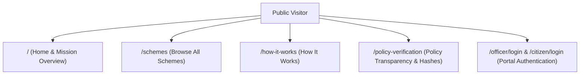

### Public Capabilities

1. **Home (`/`)**: Platform mission, overview of supported welfare domains, and direct entry points for citizens and officers.
2. **Browse Schemes (`/schemes`)**: Comprehensive catalogue of all supported central welfare policies. Citizens do **not** need to log in merely to browse public scheme information.
3. **How It Works (`/how-it-works`)**: Transparent walkthrough of the 8-stage statutory entitlement chain.
4. **Policy Transparency (`/policy-verification`)**: Cryptographic rule definition hashes (SHA-256), Gazetted order references, and active statutory policy version history.
5. **Role Authentication (`Login`)**: Entry to Citizen Portal (in progress) or Officer Access (`/officer/login`, verified) via the global role selector.

### Public Scheme Detail Pages (`/schemes/[schemeCode]`)

Every public scheme page exposes complete statutory metadata:
- **Scheme Purpose & Ministry**: Responsible government ministry, nodal agency, and program objective.
- **Eligibility Overview**: High-level statutory eligibility criteria and exclusion categories in plain language.
- **Official Policy Source**: Verified government domain source (e.g., `pmkisan.gov.in`, `dea.gov.in`).
- **Policy Version**: Active version identifier (e.g., `v3.0-2023`, `v3.0-2024`) and effective operational dates.
- **Official Document**: Direct link to official Gazetted operational guidelines (`target="_blank"`).
- **Transparency & Provenance**: Canonical rule definition SHA-256 hash guaranteeing policy integrity.

> [!NOTE]
> **Authentication Requirement**: While public scheme discovery is completely unauthenticated, personalized actions such as *"Check My Eligibility"* or *"Apply for Scheme"* require user authentication. In the current implementation, eligibility can be tested interactively with pre-seeded synthetic citizen contexts; full gating behind the unified citizen login is planned for Phase A.

---

## 4. Citizen Portal

`[STATUS: PLANNED ARCHITECTURE / IN PROGRESS — PHASE B]`

The Citizen Portal provides applicants with a dedicated, persistent environment for managing welfare applications across government programs:

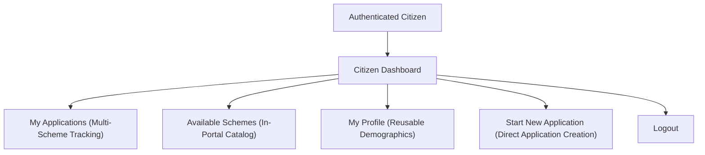

### Core Citizen Views (Planned Specifications)

- **Dashboard (`/citizen/dashboard`)**: Summary of active applications, pending actions, and recent determination decisions.
- **My Applications (`/citizen/applications`)**: Multi-application tracking view showing real-time lifecycle states across different schemes.
- **Available Schemes (`/citizen/schemes`)**: In-portal scheme catalog allowing citizens to explore and apply for new schemes directly without navigating back to the public homepage.
- **My Profile (`/citizen/profile`)**: Reusable applicant profile data (synthetic reference code, full name, state, district, communication coordinates).
- **Logout**: Secure session termination clearing client tokens.

### Multi-Application Support per Citizen

YogyataMitra is designed as a **multi-application platform**. A single citizen applicant can hold and track multiple welfare applications simultaneously across distinct schemes:

```text
Citizen (SYN-CIT-14871C2A)
├── PM-KISAN Application       [Status: Under Verification]
├── SSY Application            [Status: Decision Available (ELIGIBLE)]
├── PMUY Application           [Status: Clarification Required (Planned Scheme)]
└── PMMVY Application          [Status: Ready for Evaluation (Planned Scheme)]
```

### Profile Pre-fill vs. Immutable Application Snapshot

While common profile attributes (e.g., state, district, family composition) may be pre-filled from the citizen's profile to reduce filing friction, **every submitted application retains its own immutable snapshot of submitted and verified facts**. Subsequent updates to a citizen's profile do not mutate facts in an already submitted application.

---

## 5. Application Model & Historical Integrity

`[STATUS: IMPLEMENTED / VERIFIED (DATA MODEL & RETENTION)]`

The `EvaluationJourney` entity encapsulates the complete state of a citizen's entitlement request:

```text
Application Record (EvaluationJourney)
├── Citizen Reference (e.g., SYN-CIT-2026-001)
└── Application
    ├── Scheme Reference (e.g., PM_KISAN, SSY)
    ├── Policy Version Reference (e.g., v3.0-2023)
    ├── Canonical Rule Definition Hash (SHA-256)
    ├── Facts Snapshot (Submitted vs. Verified)
    ├── Evidence Dossier (List of Evidence Items & Storage References)
    ├── Officer Assignment (Current Pool / Assigned Officer)
    ├── Verification Records (Officer Verification Findings & Notes)
    ├── Evaluation Result (ELIGIBLE / INELIGIBLE / INSUFFICIENT_INFORMATION / VERIFICATION_REQUIRED)
    ├── Explanation Record (Bilingual Rule-by-Rule Breakdown)
    └── Audit History (Append-Only Event Trail)
```

### Historical Policy Invariant

> [!CAUTION]
> **Historical Immutable Retention**: Every application remains permanently bound to the exact `PolicyVersion` under which it was evaluated. A future statutory policy update or rule modification **must NEVER silently re-evaluate or mutate historical application decisions**. Future policy updates create a new policy version rather than mutating historical records. Historical decisions reflect statutory law as it stood on the date of evaluation.

---

## 6. Citizen Application Flow & Lifecycle States

`[STATUS: FOUNDATION IMPLEMENTED — FSM / JOURNEY ENGINE VERIFIED; COMPLETE ROUND-TRIP IN PROGRESS]`

The citizen application lifecycle moves through a well-defined, state-machine-governed workflow:

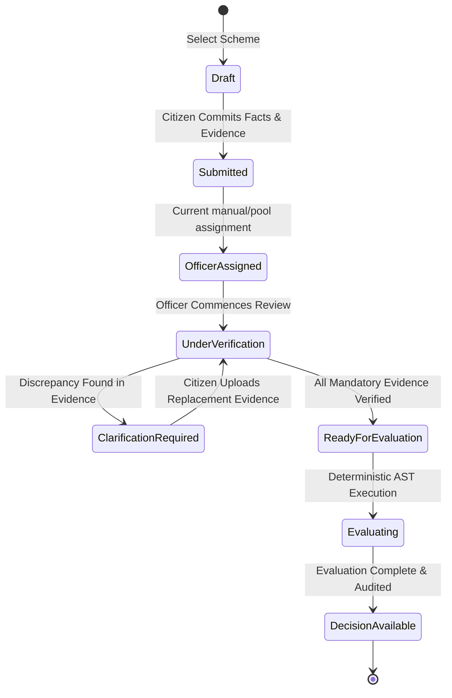

### Canonical Lifecycle States

1. **Submitted**: Citizen has committed factual claims and attached supporting evidence documents.
2. **Officer Assigned**: Application is routed to an authorized welfare officer (currently manual/pool-based; automated balancing is planned in Phase D).
3. **Under Verification**: Officer is actively inspecting evidence items against claimed criteria.
4. **Clarification Required**: Officer identified incomplete, illegible, or inconsistent evidence and requested citizen remediation.
5. **Ready for Evaluation**: All statutory mandatory facts and evidence items have attained verified status.
6. **Evaluating**: Deterministic Rule AST engine evaluates verified facts against active statutory criteria.
7. **Decision Available**: Evaluation outcome, bilingual explanation, and complete provenance trace are rendered to the applicant.

> [!NOTE]
> **Workflow Status Clarification**: The foundational state machine, state transitions, and evaluation pipeline are implemented and verified in the backend. Full end-to-end round-trip interaction between the citizen and officer portals across all lifecycle states remains in progress and planned across Phases A–E.

---

## 7. Clarification Workflow

`[STATUS: IN PROGRESS — OFFICER INITIATION VERIFIED; CITIZEN REMEDIATION UI PLANNED IN PHASE E]`

When documentary evidence does not satisfy statutory standards, YogyataMitra prevents immediate arbitrary rejection by providing a structured remediation path:

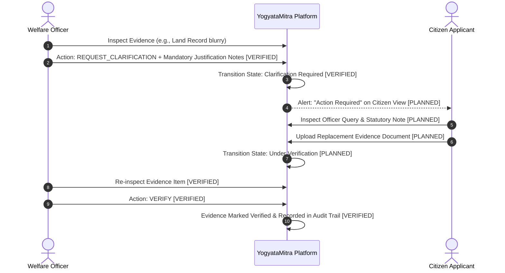

1. **Officer Trigger (`IMPLEMENTED`)**: Officer flags a specific evidence item with action `REQUEST_CLARIFICATION` and enters a mandatory justification note (e.g., *"Uploaded RoR survey number illegible in scan"*).
2. **Citizen Notification (`PLANNED - PHASE E`)**: Application banner updates to **Action Required / कार्रवाई आवश्यक**.
3. **Evidence Replacement (`PLANNED - PHASE E`)**: Citizen uploads a clear, legible replacement document or supplemental certificate.
4. **Resumed Verification (`IMPLEMENTED`)**: Application transitions back to `Under Verification`. The officer re-inspects only the flagged item and advances the case.

---

## 8. Officer Portal Architecture

`[STATUS: IMPLEMENTED / VERIFIED (CORE PORTAL, QUEUE & DOSSIER)]`

The Officer Portal is an authenticated internal back-office environment for welfare administration:

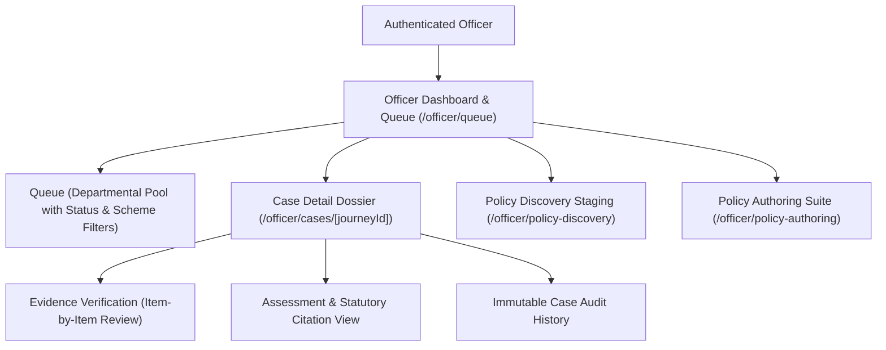

### Key Officer Views & Workflows

The Officer workflow focuses on:
- Reviewing assigned requests
- Verifying submitted evidence
- Recording verification findings
- Requesting clarification with mandatory justification notes
- Reviewing policy-linked facts
- Initiating and recording the platform's deterministic eligibility assessment
- Viewing bilingual explanations
- Reviewing immutable audit history

**View Inventory**:
- **Authentication (`/officer/login`)**: `[IMPLEMENTED]` JWT login with demo credentials for verification officers and supervisors.
- **Verification Queue (`/officer/queue`)**: `[IMPLEMENTED]` Departmental case queue supporting multi-dimensional status (`PENDING`, `IN_REVIEW`, `ESCALATED`, `COMPLETED`, `ALL`) and scheme (`PM_KISAN`, `SSY`, `ALL`) filtering. Currently operates on a departmental pool model.
- **Case Dossier (`/officer/cases/[journeyId]`)**: `[IMPLEMENTED]` Plain-language factual claims, applicant references, and case state.
- **Evidence Verification (`/officer/cases/[journeyId]`)**: `[IMPLEMENTED]` Itemized evidence examination panel supporting `VERIFY`, `REJECT`, or `REQUEST_CLARIFICATION` with mandatory officer notes.
- **Policy Review & Authoring (`/officer/policy-authoring`)**: `[IMPLEMENTED]` Maker-checker sandbox for authoring, AST diffing, test execution, and activating policy updates.
- **Policy Discovery (`/officer/policy-discovery`)**: `[IMPLEMENTED]` Automated gazette change detection and candidate staging triage.
- **Audit Trail (`/officer/cases/[journeyId]/history`)**: `[IMPLEMENTED]` Append-only event history recording every verification action and event.
- **My Requests (`/officer/my-requests`) & SLA Tabs (`Due Today`, `Overdue`)**: `[PLANNED ARCHITECTURE - PHASE D]`.

---

## 9. Officer Workload & Demonstration SLA Parameters

`[STATUS: AGGREGATE METRICS IMPLEMENTED; BALANCED ROUTING & SLA ENGINE PLANNED IN PHASE D]`

To monitor case progression and prevent administrative bottlenecks, YogyataMitra incorporates operational metrics and workload modeling:

### Current Queue Metrics (`IMPLEMENTED / VERIFIED`)

The live verification queue computes real-time operational aggregates from PostgreSQL:
- **Total Cases**: Total volume of welfare applications in the system.
- **Pending Cases**: Newly submitted applications awaiting review commencement.
- **In Review Cases**: Applications actively under evidence examination.
- **Escalated Cases**: Applications referred for supervisory second-sign-off.
- **Completed Cases**: Applications with finalized determinations.

### Planned Workload Routing Engine (`PLANNED ARCHITECTURE - PHASE D`)

In upcoming development phases, individual officer assignments will be managed by a backend routing engine tracking active officer workloads:

$$\text{Active Workload} = \text{Assigned} + \text{In Review} + \text{Clarification}$$

```text
Incoming Queue: 30 New Applications (Demonstration Example)
Active Officers: Officer A, Officer B, Officer C

Backend Routing Algorithm (Least-Loaded Assignment):
├── Officer A: 10 Applications (Assigned)
├── Officer B: 10 Applications (Assigned)
└── Officer C: 10 Applications (Assigned)
```

### Demonstration Assumptions & Disclaimers

> [!WARNING]
> **Configurable Demonstration / Project Parameters**:
> Any operational figures referenced in this repository — such as:
> - Maximum case capacity threshold (e.g., 25 concurrent cases per officer)
> - Target verification turnaround time (e.g., 1–2 day or 5-day demonstration SLA)
> - Daily throughput benchmarks or batch assignment examples (e.g., 30 requests / 3 officers ≈ 10 each)
>
> are **configurable demonstration/project parameters** established exclusively for academic simulation, system testing, and workload-balancing demonstrations.
>
> They are:
> - **NOT universal Government of India standards**
> - **NOT statutory guarantees**
> - **NOT claims about actual government service delivery SLAs**
>
> Actual statutory delivery timelines are established by relevant citizen charters, Acts of Parliament, and State Government administrative notifications.

---

## 10. Policy Review vs. Application Verification

`[STATUS: IMPLEMENTED / VERIFIED]`

YogyataMitra strictly separates **legislative policy representation** from **individual citizen verification**:

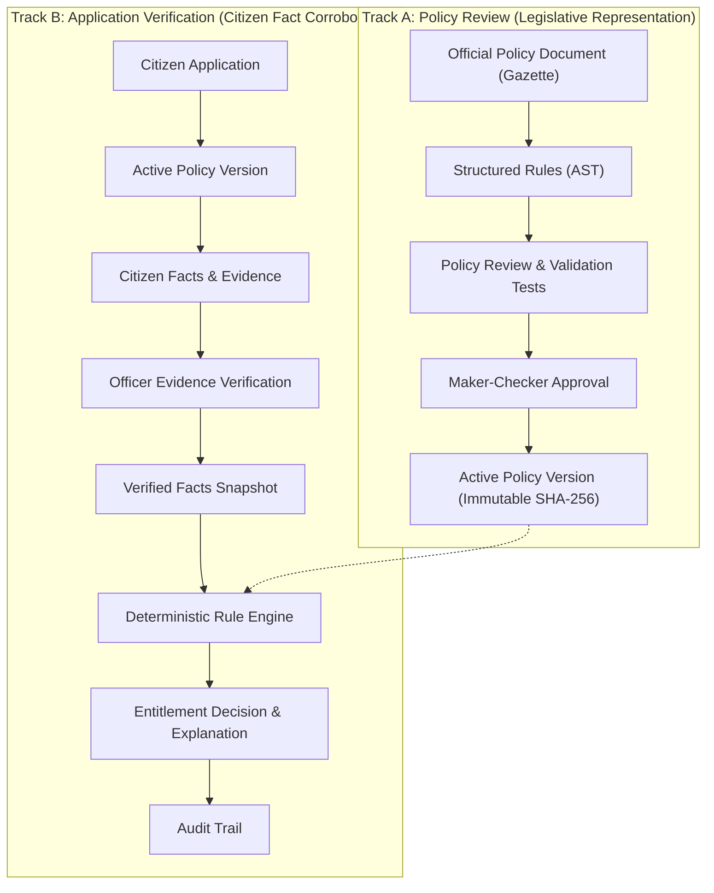

### Mandatory Structural Separation

1. **Policy Review (Legislative Track)**:
   - *Question Answered*: *"Has the Government of India Gazette notification been accurately represented as mathematical rules in the engine?"*
   - *Frequency*: Rare (only when laws, amendments, or guidelines change).
   - *Actors*: Policy Draft Author (Maker) + Reviewing Supervisor (Checker).
   - *Artifact*: A newly activated, cryptographically hashed `PolicyVersion`.

2. **Application Verification (Operational Track)**:
   - *Question Answered*: *"Are this specific applicant's submitted documents authentic and sufficient to establish their claimed facts?"*
   - *Frequency*: Continuous (for every citizen application filed).
   - *Actors*: Assigned Welfare Verification Officer.
   - *Artifact*: A `Verified Facts` snapshot passed to the Rule Engine.

> [!IMPORTANT]
> **No Manual Rule Construction**: Verification officers do **NOT** invent, interpret, or reconstruct policy rules during case examination. Policy rules are represented through the generic policy architecture and are pre-compiled and immutable; officers verify only whether the submitted factual evidence is authentic.

---

## 11. Mandatory Final Evaluation Gate

`[STATUS: IMPLEMENTATION COMPLETE — AWAITING FINAL AUDIT (PHASE F)]`

YogyataMitra does not treat unverified citizen assertions as sufficient for a final platform eligibility assessment. The evaluation gate requires all policy-mandated facts and evidence to satisfy the applicable verification conditions before deterministic evaluation can produce a final platform outcome.

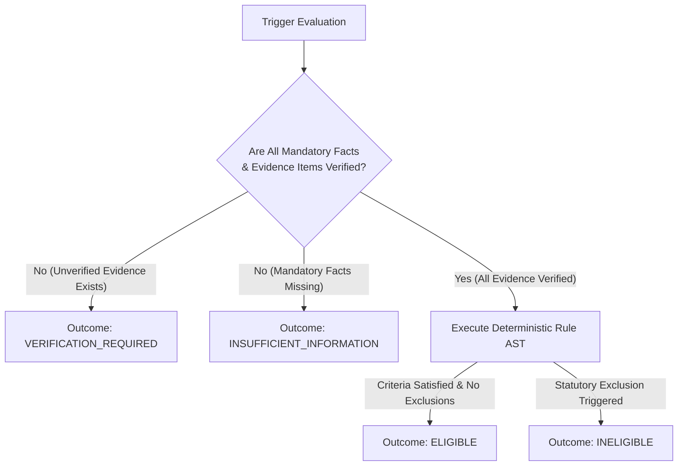

### Canonical Outcome Taxonomy

| Evaluation Outcome | Statutory Meaning | Citizen Next Step |
|---|---|---|
| **`ELIGIBLE`** | All statutory criteria satisfied; zero exclusions triggered; all mandatory evidence verified. | Proceed to official application submission or departmental receipt generation. |
| **`INELIGIBLE`** | One or more statutory exclusions triggered (e.g., income tax payer, institutional landholder). | Review bilingual explainability root cause and statutory citation. |
| **`INSUFFICIENT_INFORMATION`** | Mandatory factual fields left unanswered or unasserted by applicant. | Complete missing profile fields identified in the explainability trace. |
| **`VERIFICATION_REQUIRED`** | Facts asserted, but required documentary evidence remains unverified by an officer. | Await officer evidence verification or upload requested clarifications. |

> [!NOTE]
> **Evaluation Gate Status**: The **foundational mandatory verification gate** is implemented in the evaluator and journey service. **Phase F** represents the planned hardening of all application and evaluation paths, tri-state AST linkage, edge-case handling, and strict bypass prevention across the platform.

---

## 12. Generic Policy Architecture

`[STATUS: IMPLEMENTED / AWAITING AUDIT (Phase G)]`

To avoid maintaining fragile, scheme-specific silos, YogyataMitra operates on a unified, schema-agnostic meta-model:

```text
Generic Policy Meta-Model (IMPLEMENTED)
└── Policy Family (e.g., Agricultural Income Support)
    └── Policy Version (e.g., v3.0-2023, Effective 2023-01-01)
        ├── Policy Component / Benefit Tier (where applicable)
        ├── Deterministic RuleSet (AST Boolean Logic)
        ├── Policy Form Metadata (FormSectionDefinition, FormFieldDefinition, CrossFieldRule)
        ├── Required Facts Schema (Generic Types, Bounds, Conditions, Bilingual Labels)
        ├── Required Evidence Rules (Document Types, Acceptance Criteria)
        ├── Official Statutory Citation (Gazette ID, Reference Number)
        └── Provenance & Official Source URL

Generic Application Meta-Model (IMPLEMENTED)
└── Citizen Profile (Synthetic ID)
    └── Application (EvaluationJourney Record)
        ├── Target Scheme & Policy Version Reference
        ├── Facts Snapshot (Submitted vs. Verified)
        ├── Evidence Records (Storage pointers & verification status)
        ├── Officer Assignment & Verification Records
        ├── Evaluation Result & Kleene Execution Trace
        └── Cryptographic Audit Record
```

> [!NOTE]
> **Generic Policy-Driven Form Engine**: The complete generic policy-driven form architecture is implemented and awaiting audit under Phase G. It provides declarative version-bound form metadata (`PolicyFormMetadata`), bilingual input prompts, conditional applicability (`FieldCondition`), statutory cross-field rules (`CrossFieldRule`), and dynamic UI rendering via `PolicyFormRenderer`.

---

## 13. Ten Target Statutory Policies Portfolio

`[PORTFOLIO STATUS: 10 OF 10 IMPLEMENTED / VERIFIED (Phase H)]`

YogyataMitra's canonical target portfolio spans ten flagship Government of India social welfare programs across five vital socio-economic sectors:

### Current Implementation Status Breakdown

- **Implemented & Verified (10 Schemes, 14 Canonical Versions)**: Active in database with complete verified SHA-256 rule hashes, bilingual rule descriptions, generic form definitions, and passing statutory verification test suites.

| # | Scheme Name | Code | Nodal Ministry | Current Status | Primary Statutory Objective |
|---|---|---|---|---|---|
| 1 | **Pradhan Mantri Kisan Samman Nidhi** | `PM_KISAN` | Agriculture & Farmers Welfare | **IMPLEMENTED / VERIFIED** (3 Policy Versions: `v1.0-2018`, `v2.0-2019`, `v3.0-2023`) | Direct income support of ₹6,000/year to landholding farmer families. |
| 2 | **Sukanya Samriddhi Account** | `SSY` | Finance / Posts | **IMPLEMENTED / VERIFIED** (3 Policy Versions: `v1.0-2016`, `v2.0-2019`, `v3.0-2024`) | Small savings welfare scheme for girl children with preferential sovereign interest. |
| 3 | **PM-Kisan Maandhan Yojana** | `PM_KMY` | Agriculture & Farmers Welfare | **IMPLEMENTED / VERIFIED** (Policy Version: `v1.0-2019`) | Old age pension of ₹3,000/month for small & marginal farmers (18–40 age entry). |
| 4 | **Pradhan Mantri Ujjwala Yojana** | `PMUY` | Petroleum & Natural Gas | **IMPLEMENTED / VERIFIED** (Policy Version: `v2.0-2021`) | Clean cooking fuel (deposit-free LPG connection) for adult women from poor households. |
| 5 | **PM Vishwakarma Scheme** | `PM_VISHWAKARMA` | Micro, Small & Medium Enterprises | **IMPLEMENTED / VERIFIED** (Policy Version: `v1.0-2023`) | Holistic support, skill training, and collateral-free credit for traditional artisans/craftspeople. |
| 6 | **PMAY - Gramin** | `PMAY_G` | Rural Development | **IMPLEMENTED / VERIFIED** (Policy Version: `v1.0-2016`) | Pucca housing assistance of ₹1.20L/₹1.30L with basic amenities for homeless rural households. |
| 7 | **PMAY - Urban 2.0** | `PMAY_U_2_0` | Housing & Urban Affairs | **IMPLEMENTED / VERIFIED** (Policy Version: `v1.0-2024`) | Affordable housing assistance for Economically Weaker Sections / Low Income Groups in urban areas. |
| 8 | **PM Street Vendor's AtmaNirbhar Nidhi** | `PM_SVANIDHI` | Housing & Urban Affairs | **IMPLEMENTED / VERIFIED** (Policy Version: `v1.0-2020`) | Micro-credit working capital loans (₹10k/₹20k/₹50k) for urban street vendors. |
| 9 | **Pradhan Mantri Matru Vandana Yojana** | `PMMVY` | Women & Child Development | **IMPLEMENTED / VERIFIED** (Policy Version: `v2.0-2022`) | Maternity cash benefit (₹5,000/₹6,000) for pregnant women and lactating mothers for health/nutrition. |
| 10 | **Indira Gandhi National Old Age Pension** | `IGNOAPS` | Rural Development (NSAP) | **IMPLEMENTED / VERIFIED** (Policy Version: `v1.0-2011`) | Monthly non-contributory old-age pension for senior citizens (60+ years) living below the poverty line. |

Every policy is implemented strictly under the generic architecture: zero ad-hoc hardcoding, full rule provenance, and deterministic execution.

---

## 14. Canonical Policy Test Requirements

`[STATUS: 40 OF 40 SCENARIOS IMPLEMENTED / VERIFIED (Phase H)]`

To guarantee mathematical regression safety across the portfolio, every policy maintains at least four canonical verification test scenarios:

```text
Canonical Test Matrix (Target: Minimum 4 Scenarios per Policy × 10 Policies = 40 Scenarios)
├── 1. Clearly Eligible: All positive criteria met, zero exclusions, all evidence verified -> ELIGIBLE
├── 2. Clearly Ineligible: Triggering statutory exclusion (e.g. income tax, age) -> INELIGIBLE
├── 3. Missing Information: Mandatory factual fields left null or unknown -> INSUFFICIENT_INFORMATION
└── 4. Evidence Pending: Facts present, but required documents unverified -> VERIFICATION_REQUIRED
```

### Current Test Verification Status

- **Implemented & Verified (40 Scenarios across all 10 Schemes)**:
  - 4 canonical scenarios verified for each of: `PM_KISAN`, `SSY`, `PM_KMY`, `PMUY`, `PM_VISHWAKARMA`, `PMAY_G`, `PMAY_U_2_0`, `PM_SVANIDHI`, `PMMVY`, and `IGNOAPS` in `backend/tests/test_generic_policy_forms_phase_h.py`. All 40 canonical outcomes verified with 0 regressions.

---

## 15. Policy Versioning & Evolution Semantics

`[STATUS: IMPLEMENTED / VERIFIED]`

Statutory welfare policies evolve through legislative amendments, operational circulars, and Gazetted notifications. YogyataMitra models this temporal evolution with complete mathematical rigor:

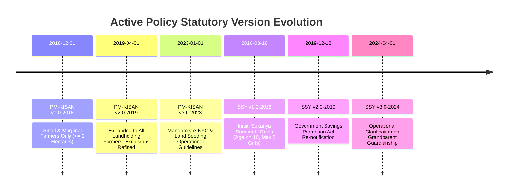

### Versioning Principles

1. **Explicit Effective Dates**: Every version defines `effective_from` and optional `effective_to` dates.
2. **Deterministic Time-Travel Evaluation**: An application evaluated on historical facts is executed against the policy version active on the statutory evaluation date.
3. **Cryptographic Rule Anchoring**: Every version stores the SHA-256 hash of its serialized rule definition:
   $$\text{RuleHash} = \text{SHA256}(\text{CanonicalJSON}(\text{RuleSet}))$$
4. **Immutability**: Once approved, a policy version's ruleset can never be edited in-place. Changes require drafting a new version.
5. **Historical Integrity**: Future policy changes do not rewrite historical applications, historical facts, evidence verifications, decisions, explanations, or audit trails.

---

## 16. Policy Update Detection Workflow

`[STATUS: DISCOVERY & REVIEW SANDBOX FOUNDATION IMPLEMENTED; CONTINUOUS MONITORING PLANNED IN PHASE J]`

YogyataMitra implements change discovery paired with strict human review gates:

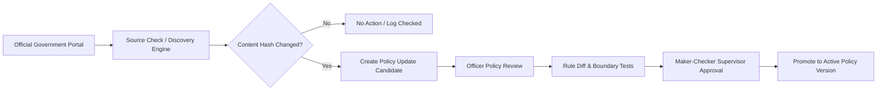

> [!WARNING]
> **No Automated Rule Mutation**: A detected change in an official document **NEVER** automatically updates active production rules. Discovered candidates are quarantined in staging until an authorized policy officer creates a draft, writes regression tests, and a reviewing supervisor approves the new version.
>
> **Status Distinction**: Foundational policy discovery, candidate comparison, and the authoring review sandbox are implemented and verified. Continuous scheduled monitoring and automated government-source ingestion pipelines remain planned under **Phase J**.

---

## 17. Official Policy Documents & Provenance Hardening

`[STATUS: IMPLEMENTED / VERIFIED (PHASE I)]`

Phase I establishes an audit-grade, tamper-evident statutory provenance chain connecting platform eligibility decisions back to authoritative Government of India publications:

```mermaid
flowchart LR
    DEC["1. Entitlement Decision"] --> TRACE["2. EvaluationTrace"]
    TRACE --> RULE["3. Structured Rule (AST)"]
    RULE --> RPROV["4. Rule Provenance (Clause Locator)"]
    RPROV --> PV["5. PolicyVersion (Rule Hash)"]
    PV --> BIND["6. PolicySourceBinding"]
    BIND --> DOCVER["7. OfficialDocumentVersion (Doc Hash)"]
    DOCVER --> DOC["8. OfficialDocument"]
    DOC --> SRC["9. OfficialSource (.gov.in/.nic.in)"]
```

### Statutory Provenance Data Model

The platform introduces six dedicated relational models under `backend/app/models/provenance.py`:

1. **`OfficialSource`**: Authoritative government publishers, ministries, and state departments. Enforces canonical URLs and strict `.gov.in`/`.nic.in` domain validation.
2. **`OfficialDocument`**: Statutory master documents (Gazette Notifications, Operational Guidelines, Parliamentary Acts, Ministry Circulars, Scheme Manuals).
3. **`OfficialDocumentVersion`**: Versioned editions/revisions of official documents. Maintains publication dates, effective dates, supersession tracking, and independent SHA-256 document artifact hashes.
4. **`PolicySourceBinding`**: Immutable junction binding an enacted platform `PolicyVersion` to one or more `OfficialDocumentVersion`s (primary, supplementary, amendment, gazette).
5. **`RuleProvenance`**: Clause-level attribution binding individual AST rules to specific paragraphs, clauses, or statutory sub-sections (e.g., `Clause 3(b)(v)`).
6. **`ProvenanceAuditEvent`**: Immutable, append-only chronological log recording all provenance registrations, bindings, and status supersessions.

### Cryptographic Hash Separation Invariant

> [!IMPORTANT]
> **Separation of Rule Logic Hash from Document Artifact Hash**:
> - **Rule Definition Hash (`PolicyVersion.rule_definition_hash`)**: The 64-character hex SHA-256 digest of the canonical, normalized AST JSON specification (`RuleSet.definition_json`). Represents machine-executable logic.
> - **Document Artifact Hash (`OfficialDocumentVersion.document_hash`)**: The SHA-256 digest of the physical binary file (e.g., official PDF issued by the ministry).
> - **Honest Hashing**: Where official documents are registered via authoritative online URLs without a locally cached binary PDF, `document_hash` is honestly set to `None` with `provenance_completeness = COMPLETE`. Synthetic or fabricated document hashes are strictly prohibited.

### Public Read-Only Transparency API

- `GET /api/v1/provenance/schemes/{scheme_code}`: Full provenance dossier for a scheme including official sources, documents, version editions, and bound policy versions.
- `GET /api/v1/provenance/policies/{policy_version_id}`: All official documents bound to a specific policy version with clause counts and ruleset hashes.
- `GET /api/v1/provenance/rules/{policy_version_id}/{rule_id}`: Precise statutory citation, clause locator, document version, and official portal URL for an individual rule.
- `GET /api/v1/provenance/documents/{document_id}`: Document metadata with complete version revision history.
- `GET /api/v1/provenance/sources`: List of all registered government publisher portals.
- `GET /api/v1/provenance/audit-trail`: Chronological audit trail of all provenance registration and binding events.

### The Anti-Forgery Invariant

> [!CAUTION]
> **Zero Forgery Policy**: YogyataMitra never generates, displays, or simulates fake government seals, forged signatures, official letterheads, or counterfeit official certificates.
>
> Sample documentary artifacts provided for demonstration, testing, or academic evaluation are watermarked and prominently labeled:
>
> $$\mathbf{\text{DEMO DOCUMENT \textbullet\ NOT VALID FOR STATUTORY PURPOSES \textbullet\ FOR DEMONSTRATION ONLY}}$$

---

## 18. Bilingual Explainability & Auditability

`[STATUS: IMPLEMENTED / VERIFIED]`

YogyataMitra replaces the black-box opacity of conventional administrative software with transparent, bilingual reasoning:

### Citizen-Facing Explanation

Every evaluated citizen receives a clear, plain-language breakdown answering:
1. **What was checked?** (e.g., *"Agricultural Land Ownership, Institutional Exclusions, Annual Tax Filings"*).
2. **Which policy version was applied?** (e.g., *"PM-KISAN Operational Guidelines v3.0-2023"*).
3. **Which facts supported the outcome?** (e.g., *"Cultivable landholding of 1.5 hectares confirmed"*).
4. **Which evidence was verified?** (e.g., *"Land Record (RoR) verified by Welfare Officer on 2026-09-26"*).
5. **Which rule passed or failed?** (Clear criteria cards with zero technical jargon or raw database keys).
6. **What is the immediate next step?** (Actionable guidance on how to resolve missing evidence or appeal).

### Officer-Facing Audit Trail

Authorized officers inspect a comprehensive technical audit trace:
- Full Strong Kleene tri-state AST execution trace.
- Evaluated leaf node paths and boolean short-circuit decisions.
- Cryptographic SHA-256 rule definition hashes.
- Application submission, officer assignment, evidence verification, and clarification event records.
- Immutable event logs stored in append-only PostgreSQL audit tables (`HumanReviewAuditEvent`).

---

## 19. Generative AI Safety & Quarantine Boundary

`[STATUS: IMPLEMENTED / VERIFIED]`

YogyataMitra establishes a strict architectural boundary governing the use of Generative AI:

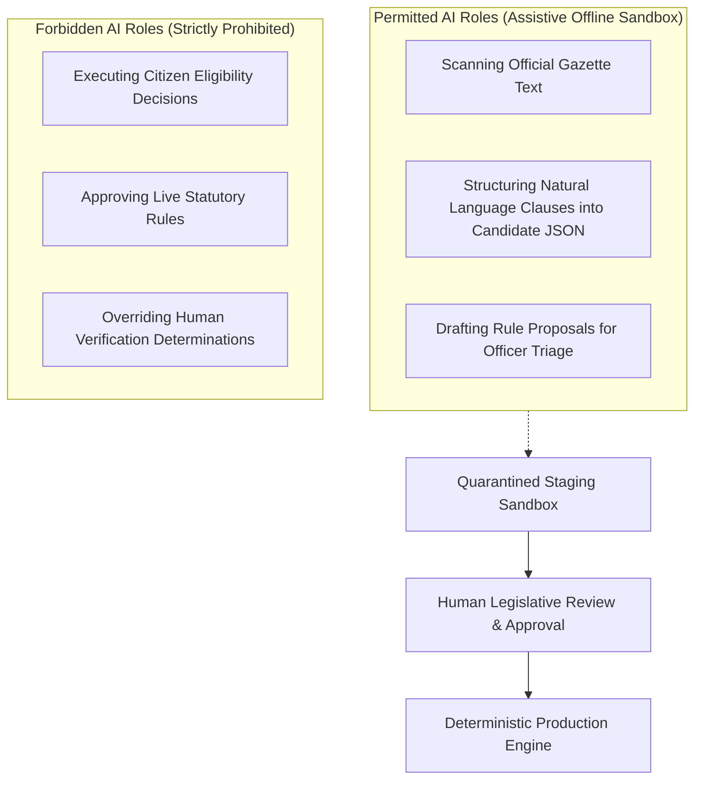

- **Permitted**: Assisting policy authors by ingesting gazette text, proposing draft rule structures, and suggesting regression test cases.
- **Prohibited**: Direct evaluation of citizen eligibility, dynamic modification of production rules, or unmonitored decision-making.
- **Quarantine Invariant**: All AI-assisted discoveries are quarantined in `policy_drafts` and cannot evaluate live citizen data until formally approved by human officers.

---

## 20. Government Design System & Motion Principles

`[STATUS: IMPLEMENTED / VERIFIED; USABILITY POLISH PLANNED IN PHASE K]`

The user interface of YogyataMitra is designed according to the Digital India and National Portal design standards:

### Aesthetic & Visual Identity

- **Color Palette**: Deep National Navy (`#0A192F`, `#1E3A8A`), Tiranga Saffron (`#FF9933`), Tiranga Green (`#138808`), and Gov Slate (`#F8FAFC`, `#E2E8F0`).
- **Typography**: Clean, accessible sans-serif hierarchy (Inter / system fonts) designed for high readability in both Latin and Devanagari scripts.
- **Components**: High-contrast cards, crisp borders, subtle status badges (`border`, `bg`, `text`), clear breadcrumbs, and accessible focus rings (`focus-visible:ring-2`).

### Restrained Motion Guidelines

Motion in YogyataMitra is subtle, purposeful, and functional:
- **Tab Transitions**: Smooth sliding underlines for mode switches.
- **Status Badges**: Gentle fade-in and scale transitions on state change.
- **Workload Counters**: Subtle numerical transitions when assigned counts update.
- **Interactive Modals**: Controlled, accessible dialog transitions with focus retention.
- **Prohibited**: Distracting gaming visual effects, floating decorative blobs, excessive gradients, glassmorphism, or frivolous animations that hinder accessibility.

Accessibility is maintained as an ongoing quality requirement across all components.

---

## 21. Real-Time State & Synchronization

`[STATUS: IMPLEMENTED / VERIFIED]`

YogyataMitra prioritizes factual UI synchronization:

1. **Accurate State Reflection**: UI states represent the true backend PostgreSQL state machine condition.
2. **Efficient Polling**: Background state polling (via TanStack React Query) keeps citizen application status and officer queues synchronized during live workflows.
3. **Future Extension**: Architectural hooks allow WebSockets or Server-Sent Events (SSE) for instant push updates in high-volume environments.
4. **Zero Simulated Activity**: The application never generates artificial progress bars, simulated delays, or fake real-time activity.

---

## 22. Architectural Implementation Principles

1. **Scheme Agnosticism**: Evaluator and verification layers contain zero scheme-specific code branches.
2. **Metadata-Driven Form Architecture**: Citizen claim forms and validation schemas are designed to be generated from declarative policy metadata; the complete metadata-driven form engine is planned in Phase G.
3. **Policy-Driven Evidence**: Documentary evidence requirements (acceptable document types, max sizes, validity periods) are defined within the policy ruleset.
4. **Decoupled Architecture**: Presentation, business services, rule reasoning, and data persistence remain strictly modular.
5. **Defensive Coding**: All API requests enforce Pydantic v2 validation with `extra="forbid"` to prevent payload injection.

---

## 23. Development & Release Roadmap

The project development sequence follows a structured eleven-phase progression:

```text
EXISTING VERIFIED ENGINEERING BASELINE:
├── Components Verified from Earlier Development Phases
│   ├── Pure Deterministic Kleene Rule AST Evaluator
│   ├── PM-KISAN & SSY Statutory Rulesets (6 Frozen Policy Versions)
│   ├── Foundational Mandatory Verification Evaluation Gate
│   ├── Generic Policy & Application Domain Foundation
│   ├── Officer Verification Portal & Departmental Queue
│   ├── Itemized Evidence Verification & Notes
│   ├── Policy Discovery & Sandbox Review Foundation
│   ├── Policy Authoring, Diffing & Maker-Checker Approval
│   ├── Bilingual English & Hindi Citizen Explanations
│   └── Append-Only Audit Logging & Public Transparency Views

ROADMAP PHASES (DO NOT REORDER):
├── PHASE A — Authentication & Role Routing
├── PHASE B — Citizen Dashboard / My Applications / Profile
├── PHASE C — Generic Application Creation & Submission
├── PHASE D — Officer Assignment / Workload / SLA
├── PHASE E — Clarification Loop
├── PHASE F — Evaluation Gate Hardening
├── PHASE G — Generic Policy-Driven Forms
├── PHASE H — Ten Policy Implementations
├── PHASE I — Provenance Enhancements / Official Document Handling
├── PHASE J — Policy Monitoring / Review
└── PHASE K — UI Polish / Restrained Motion / Usability
```

---

## 24. Engineering Integrity & Rules of Operation

All development inside `D:\YogyataMitra` strictly adheres to sovereign engineering rules:

- **Absolute Isolation**: Work only within canonical root `D:\YogyataMitra`. Never access, read, copy, or reference `D:\YogyataMitra-main`.
- **Pre-Flight Inspection**: Always inspect existing models, services, and tests before introducing modifications.
- **Non-Regression**: Preserve existing working statutory logic, database constraints, and passing tests.
- **Audit Logging**: Report all file changes, schema modifications, API updates, and test outcomes transparently.
- **Statutory Accuracy**: Rules must derive exclusively from verified government operational guidelines. Never invent statutory policy rules.

---

## 25. Definition of Done & Delivery Status

The YogyataMitra platform implementation status is rigorously tracked across completed, immediate next, and future roadmap phases:

### Category A: CURRENT STATE — Verified & Implemented Baseline

The following core capabilities are physically implemented, verified against automated test suites, and operational in `D:\YogyataMitra`:

- [x] **Deterministic AST Evaluator**: Schema-agnostic Strong Kleene 3-valued logic engine executing without heuristic shortcuts.
- [x] **Officer Authentication & RBAC**: Secure credential login (`/officer/login`) with role validation (`OFFICER`, `SUPERVISOR`, `ADMIN`).
- [x] **Departmental Queue & Inspection**: `/officer/queue` with status and scheme filters, and full case dossier views (`/officer/cases/[journeyId]`).
- [x] **Itemized Evidence Verification**: Verification determinations (`VERIFIED`, `REJECTED`, `CLARIFICATION_REQUESTED`) with mandatory justification notes.
- [x] **Active Policy Rulesets (2 Flagship Schemes)**: `PM_KISAN` (3 versions) and `SSY` (3 versions) = 6 canonical policy versions with frozen SHA-256 hashes.
- [x] **Canonical Test Baseline (8 Scenarios)**: 4 canonical scenarios each for `PM_KISAN` and `SSY` executing and passing in the test suite.
- [x] **Historical Version Retention**: Immutable binding of journeys to historical policy version IDs and rule definition hashes.
- [x] **Policy Discovery Sandbox**: Quarantined candidate staging, content hash comparison, and triage interface in `/officer/policy-discovery`.
- [x] **Policy Authoring & Approval Suite**: AST rule compiler, validator, diffing engine, test runner, and supervisor promotion in `/officer/policy-authoring`.
- [x] **Foundational Mandatory Verification Gate**: Core gate in evaluator blocking unverified evidence from rendering binding decisions.
- [x] **Generic Domain Foundation**: Domain metadata and application journey models supporting schema-agnostic evaluation.
- [x] **Bilingual Citizen Explanations**: English and Hindi plain-language rule summaries, 6-question breakdown, and criteria presentation.
- [x] **Append-Only Auditability**: Cryptographically anchored audit trail capturing evaluation traces and officer actions.
- [x] **Official Document Provenance Foundation**: Direct `.gov.in`/`.nic.in` gazette links in `officialSources.ts` and mandatory anti-counterfeiting watermark on demo files.
- [x] **Government Design System**: National Navy/Tiranga visual tokens, Inter/Devanagari typography, and restrained micro-interactions.

- [x] **PHASE A — Authentication & Role Routing**: COMPLETE & FROZEN (`/citizen/login`, `/citizen/signup`, role-isolated JWT tokens, unified role selector).
- [x] **PHASE B — Citizen Dashboard / My Applications / Profile**: COMPLETE & FROZEN (`/citizen/dashboard`, `/citizen/applications`, multi-scheme tracking, IDOR isolation).
- [x] **PHASE C — Generic Application Creation & Submission**: COMPLETE & FROZEN (`/citizen/applications/new`, draft lifecycle, requirement preflight, immutable submission).
- [x] **PHASE D — Officer Assignment / Workload / SLA**: COMPLETE & FROZEN (`/officer/queue`, `/officer/cases/[journeyId]`, least-loaded auto-assignment, operational SLA tracking, service-enforced reassignment authorization, audit logging).
- [x] **PHASE E — Operational Evidence Verification & Clarification Workflow**: COMPLETE & FROZEN (Multi-round evidence verification findings, officer clarification requests, citizen responses with replacement evidence, immutable history preservation, backend-derived verification completeness readiness, and IDOR protection).
- [x] **PHASE F — Deterministic Evaluation & Decision Engine**: COMPLETE & FROZEN (Pure AST evaluation against bound policy version, 4 statutory outcomes (`ELIGIBLE`, `INELIGIBLE`, `INSUFFICIENT_INFORMATION`, `VERIFICATION_REQUIRED`), server-side verified fact provenance gate, row-level concurrency locking, append-only `EvaluationTrace` with journey linkage, officer assignment auth, citizen decision IDOR, bilingual statutory disclaimers, and 31 automated regression tests passing cleanly in `tests/test_deterministic_evaluation_phase_f.py`).

- [x] **PHASE G — Generic Policy-Driven Forms**: COMPLETE & FROZEN (Dynamic metadata-driven citizen form architecture, declarative version-bound policy metadata registry `PolicyFormMetadata`, bilingual sections/prompts, generic field types, deterministic conditional logic `FieldCondition`, statutory cross-field rules `CrossFieldRule`, authoritative server-side validation `validate_citizen_form_submission`, dynamic frontend renderer `PolicyFormRenderer`, and 17 dedicated automated tests in `tests/test_generic_policy_forms_phase_g.py`).
- [x] **PHASE H — Ten Statutory Government Schemes**: COMPLETE & FROZEN (Universal coverage of all 10 statutory central schemes across 14 canonical policy versions: `PM_KISAN`, `SSY`, `PM_KMY`, `PMUY`, `PM_VISHWAKARMA`, `PMAY_G`, `PMAY_U_2_0`, `PM_SVANIDHI`, `PMMVY`, `IGNOAPS`. 40/40 canonical test scenarios passing in `tests/test_generic_policy_forms_phase_h.py`).

- [x] **PHASE I — Official Documents & Provenance Hardening**: COMPLETE & FROZEN (Authoritative official source registry `OfficialSource`, official document registry `OfficialDocument`, document editions `OfficialDocumentVersion`, strict SHA-256 physical document hashing separated from rule definition AST hash, policy-version to document bindings `PolicySourceBinding`, rule-level clause locators `RuleProvenance`, public read-only transparency REST API `/api/v1/provenance/*`, officer policy provenance transparency UI, append-only provenance audit trail `ProvenanceAuditEvent`, and 25 dedicated automated tests in `tests/test_provenance_phase_i.py`).

### Category B: CURRENT WORK — Implemented & Awaiting Audit

- [x] **PHASE J — Production Hardening, End-to-End Verification & Demonstration Readiness**: IMPLEMENTED / AWAITING INDEPENDENT FREEZE AUDIT
  - **End-to-End Multi-Role Lifecycle Harness**: Complete round-trip lifecycle from citizen discovery to policy binding, draft creation, factual declaration, evidence submission, officer queue, assignment, itemized evidence verification, multi-round clarification, deterministic evaluation, trace generation, decision explanation, and audit trail (`tests/test_phase_j_end_to_end.py`).
  - **Universal 10-Scheme Statutory Matrix**: End-to-end verification covering all 10 central schemes (`PM_KISAN`, `SSY`, `PM_KMY`, `PMUY`, `PM_VISHWAKARMA`, `PMAY_G`, `PMAY_U_2_0`, `PM_SVANIDHI`, `PMMVY`, `IGNOAPS`) across both positive ELIGIBLE determinations, disqualifications, and unverified evidence blocks.
  - **Authoritative Deterministic Evaluation Gate**: Re-verified pure AST evaluation invariant (`Verified Facts + Bound Policy Version + Deterministic AST Rule Engine = Evaluation Result`) with zero LLM/heuristic tampering.
  - **Provenance Model & Migration Hardening**: Expanded `ProvenanceCompleteness` enum with `SOURCE_METADATA_VERIFIED` and `PHYSICAL_ARTIFACT_VERIFIED`, accompanied by migration `d4e5f6a7b8c9`.
  - **Audit Trail Database Immutability**: PostgreSQL trigger `trg_provenance_audit_events_immutable` preventing direct `UPDATE` or `DELETE` on `provenance_audit_events` (migration `c3d4e5f6a7b8`).
  - **Public Provenance API Sanitization**: Authoritative stripping of local server filesystem paths (`C:\`, `D:\`, `/`, `file://`) from public provenance endpoints while preserving official `.gov.in`/`.nic.in` URLs.
  - **Synthetic Demo Seed & Reset Script**: Deterministic idempotent script (`backend/scripts/demo_seed_reset.py`) generating synthetic citizens and draft journeys with complete cleanup capability (`--reset`).
  - **Automated Test Verification**: 32/32 Phase J integration tests passing, 212/212 full backend regression tests passing, 137/137 frontend unit tests passing, 0 TypeScript errors, 0 ESLint errors, clean production Next.js build.
  - **Status Invariant**: Phase J is explicitly NOT declared frozen; awaiting independent freeze audit.

### Category C: FUTURE WORK — Subsequent Roadmap Phases

The following capabilities belong to subsequent platform expansion phases:

- [ ] **PHASE K — UI Polish / Restrained Motion / Usability**: Final usability refinements, restrained motion audits, contrast verification, and accessibility adherence across all portals.

---

## 26. Quickstart & Installation Guide

### Prerequisites

- **Python**: 3.11+
- **Node.js**: 18.18+ / 20+
- **PostgreSQL**: 16+ (running on port `5432` or `5433`)

### Backend Setup

```bash
# Navigate to backend directory
cd D:\YogyataMitra\backend

# Activate virtual environment
.venv\Scripts\activate

# Install dependencies
pip install -r requirements.txt

# Run database migrations
alembic upgrade head

# Launch FastAPI development server
uvicorn app.main:app --host 0.0.0.0 --port 8000 --reload
```

### Frontend Setup

```bash
# Navigate to frontend directory
cd D:\YogyataMitra\frontend

# Install dependencies
npm install

# Launch Next.js development server
npm run dev
```

The frontend will be accessible at `http://localhost:3000` and the API gateway at `http://localhost:8000`.

---

## 27. License & Attribution

- **Software Source Code**: Distributed under the MIT License.
- **Statutory Policy Rules & Gazetted Summaries**: Public Domain / Government Open Data under the National Data Sharing and Accessibility Policy (NDSAP) of India.
- **Brand & Emblems**: YogyataMitra is an open GovTech research and engineering initiative. All respective ministry names and program marks are properties of the Government of India.
